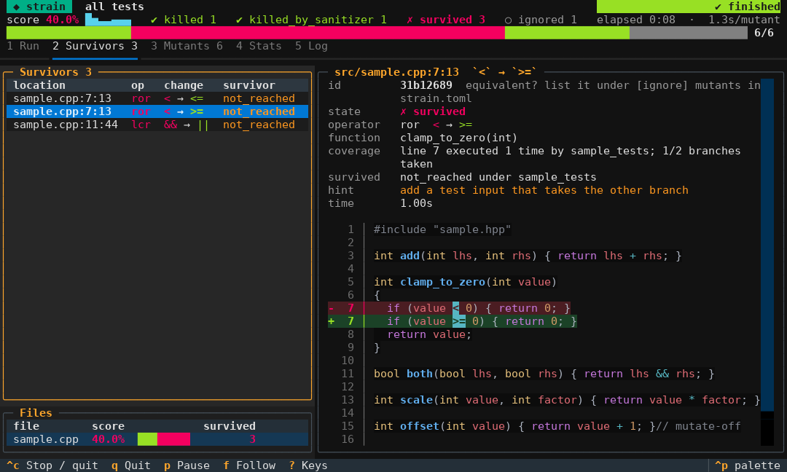

# mutant_strain

[](https://github.com/cpp-best-practices/mutant_strain/actions/workflows/ci.yml)
[](https://scorecard.dev/viewer/?uri=github.com/cpp-best-practices/mutant_strain)

**Mutation testing for C++ projects built with CMake and tested with CTest.**

strain changes your code in small ways (`<` becomes `<=`, `&&` becomes `||`) and checks whether your tests notice. Every mutant that survives points at a test that runs the code but doesn't really check it.



*`strain run --ui live` on `tests/fixtures/sample_project` after the run, with the second survivor selected.*

> **Status:** design stage, not yet usable.
> Design doc: <!-- TODO(claude): link the design doc -->

<!--
Notes for whoever fills this in (human or Claude Code):
- Every `TODO(claude)` marks a gap to fill once the code exists.
- Keep the README short and bullet-driven; deep detail belongs in docs/.
- When a section is filled, remove its TODO marker.
-->

---

## Why strain

- **Results in minutes:** tests are mutated one at a time, so you see the first results without a full-suite baseline.
- **Works with your toolchain:** GCC or Clang, Ninja or Makefiles. No compiler plugin required.
- **Sanitizers count:** a mutant caught by ASan or UBSan counts as killed, and is reported separately.
- **Action items, not just a score:** pseudo-tested functions, tests that kill nothing, and a concrete hint for each survivor.
- **Minimal dependencies:** the core is the Python standard library only.

## Requirements

- Python 3.11+ <!-- TODO(claude): confirm minimum version -->
- CMake 3.14+ and CTest
- git, with a clean working tree
- GCC 9+ with `gcov` (v1), or Clang with `llvm-cov` (planned)
- Optional:
  - `cppcheck`: the best mutation engine
  - `tree-sitter`: the fallback engine (pip)
  - `textual`: the live TUI, `--ui live` (pip)

## Install

```sh
# TODO(claude): replace once packaging exists
pip install strain            # core
pip install "strain[ui]"      # with the live TUI
```

## Quick start

### 1. Configure a build for strain

strain needs coverage, sanitizers and a compilation database:

```sh
cmake -S . -B build-strain -G Ninja \
  -DCMAKE_BUILD_TYPE=Debug \
  -DCMAKE_EXPORT_COMPILE_COMMANDS=ON \
  -DCMAKE_CXX_FLAGS="--coverage -fsanitize=address,undefined -fno-omit-frame-pointer -D_GLIBCXX_ASSERTIONS -ftrivial-auto-var-init=pattern" \
  -DCMAKE_EXE_LINKER_FLAGS="--coverage -fsanitize=address,undefined"
cmake --build build-strain
```

<!-- TODO(claude): add a CMakePresets.json example and a Clang variant -->

### 2. Run it

```sh
strain run --build-dir build-strain              # all tests
strain run --build-dir build-strain -R parser    # only tests matching "parser"
strain run --build-dir build-strain --since main # only lines changed since main
```

Add `--ui live` (with `strain[ui]` installed) to watch the run in a full-screen TUI, described [below](#live-tui).

### 3. Read the results

<!-- TODO(claude): paste a real console summary once one exists -->

With many survivors, start with the **patterns**. They group survivors that make the same kind of change in the same
file, such as every `&&` → `||` or every comparison moved by one at its limit, and each group names the test that would
kill all of them. Each survivor is in one group at most. **Hotspots** are the functions with the most survivors.

```text
parser_tests   score 87.8%   killed 31  sanitizer 4  timeout 1  survived 5

Patterns
  · 3 survivors turn `&&` into `||` in lexer.cpp: add inputs that must be rejected, since the tests check only what is accepted
  · hotspot: parse_header() in parser.cpp has 3 survivors: 1 not_reached, 2 not_detected

Action items
  1. parse_header() is pseudo-tested: nothing checks its result
  2. lexer.cpp:88  `==` → `!=` survived (not_reached): add a test where tok != END
  3. parser.cpp:97 `+` → `-` survived (not_detected): assert the computed offset
```

## Live TUI

`strain run --ui live` shows the run in a full-screen TUI built on [Textual](https://textual.textualize.io/). Without
Textual installed, it warns and prints plain output instead. Use the keyboard or the mouse.

| View | Shows |
|------|-------|
| `1` Run | The mutated code as a highlighted diff, the mutant queue with each result and time, findings and the build log |
| `2` Survivors | Each survivor with its coverage, the tests it survived, a hint and its source, and the score of each file |
| `3` Mutants | Every mutant so far, filtered by state, with the same details |
| `4` Stats | The [safety nets](#safety-nets) the configuration let fail, why each matters and how to fix it; scores by file, operator and test; the slowest mutants |
| `5` Log | The full console output |

Above the views, the header shows the score with its history, the totals, the elapsed time and an estimate of the time
left. When a safety net fails but its level is `warn` or `ignore`, a `! N safety nets off` badge appears there; click it
for the details. It is red when one of those nets errors by default, because then a mutant that breaks the code can
survive, and each survivor's details carry the same caution. Under it, a bar has one cell per mutant, colored by its result: hover to name a mutant, click to show it in the
queue.

| Key | Does |
|-----|------|
| `1`–`5`, `tab`, `shift+tab` | Switch views; or click a tab |
| `↑` `↓`, `PgUp` `PgDn` | Move through a list; in Run, look at another mutant while the run goes on |
| `enter` | In Run, open the selected mutant in Mutants |
| `f` | In Run, follow the running mutant again; in Mutants, show the next state filter |
| `p` | Pause before the next mutant starts, with the sources unmutated; press again to resume |
| `ctrl+c` | Stop the run: strain restores the sources and writes the reports, as with `--resume` |
| `q` | Leave once the run has finished, then print the plain summary |
| `?`, `ctrl+p` | Show every key; open the command palette, which also changes the theme |

## How it works

For each selected test:

1. **Baseline:** run the test unmutated and collect its coverage. If it fails, reports UB or times out, it's excluded.
2. **Generate mutants** on the lines this test executed, in a fixed, reproducible order.
3. For each mutant:
   1. Mutate the source, with the original saved to a journal first.
   2. Reject it early if `-fsyntax-only` fails, or without touching the source if it is [known to break the build](#build-cache).
   3. Rebuild incrementally with `cmake --build`.
   4. Run the test and classify the result.
   5. Restore the file, always, even on Ctrl-C.

Interrupted runs continue with `--resume`.

### Build cache

A mutant that doesn't compile is a `compile_error` for every test, so strain builds it only once:

- Later tests in the same run, and later runs, report it straight away, with no mutation and no rebuild.
- The cache lives in `<build-dir>/strain-cache/`, one file per commit and compilation database. A new commit or a reconfigured build starts with an empty cache.
- `--no-build-cache` ignores the saved cache and doesn't save to it. Within a run, failures are still remembered.

## Result states

| State | Meaning | Counts toward score |
| --- | --- | --- |
| `killed` | A test failed | Yes |
| `killed_by_sanitizer` | ASan or UBSan caught it, the assertions didn't | Yes, flagged |
| `timeout` | Ran too long | Yes |
| `survived` | All tests passed | Yes |
| `skipped_unevaluated` | Operand never evaluated by this test | No |
| `compile_error` | Didn't compile | No |
| `ignored` | Suppressed by config or `// mutate-off` | No |

Survivors are labeled `not_reached` (needs a new test input) or `not_detected` (needs a stronger assertion) when branch coverage is available.

Mutation score = (killed + killed_by_sanitizer + timeout) ÷ (those + survived)

## Safety nets

strain checks every translation unit for:

- ASan
- UBSan
- standard library assertions
- pattern auto-init

Each check is `error`, `warn` or `ignore`; the default is `error`.

```sh
strain run --safety-nets=warn
```

<!-- TODO(claude): document per-check overrides in the config file -->

## CLI reference

<!-- TODO(claude): generate from the real argument parser -->

| Option | Default | Description |
| --- | --- | --- |
| `--build-dir` | `.` | CMake build folder |
| `-R` / `-E` | | Include / exclude tests by regex, as in ctest |
| `--since <ref>` | | Mutate only lines changed since a git ref |
| `--strategy` | `per-test` | `per-test`, or `per-mutant`: build each mutant once and run its covering tests, fastest first, until one detects it |
| `--skip-killed` | off | Skip mutants an earlier test already killed |
| `--no-build-cache` | off | Don't reuse or save the [build cache](#build-cache) |
| `--engine` | `auto` | `cppcheck`, `tree-sitter`, `lexer` |
| `--coverage` | `auto` | `gcov`, `llvm-cov`, `lcov`, `gcovr` |
| `--ui` | `auto` | `live`, `log`, `json` |
| `--safety-nets` | `error` | `error`, `warn`, `ignore` |
| `--threshold` | | Exit non-zero below this score |
| `--strict` | off | Abort if any test is excluded |
| `--max-per-line` | | Cap mutants per source line |
| `--resume` | | Continue an interrupted run |
| `--all` | off | Show every survivor, not just the top actions |

## Configuration

<!-- TODO(claude): finalize file name, schema and precedence vs CLI -->

```toml
# strain.toml
exclude = ["tests/**", "third_party/**"]
arid = ["LOG_*", "spdlog::*"]

[safety_nets]
asan = "error"
ubsan = "error"
stdlib_assertions = "error"
auto_var_init = "warn"

[ignore]
mutants = ["a1b2c3d4"]   # equivalent mutants, by ID
```

To suppress mutants in source, add `// mutate-off` to the line.

## Reports

Written to `strain-report/` <!-- TODO(claude): confirm path -->:

- `index.html`: a browsable report, with each source annotated
- `summary.md`: the score, the files and the survivors, for a CI job summary or a pull request comment
- `report.json`: full results, in the mutation-testing-elements schema, plus a `patterns` array: each group of
  survivors with its kind, file, advice and mutant IDs, and the hotspots with `"primary": false`
- `events.jsonl`: every event of the run
- compiler-style warnings on the console (`file:line:col: warning: survived [ror]`), clickable in editors

## CI

strain's exit status is what a CI job should fail on:

- **Non-zero when nothing was tested:** without `--since`, strain exits non-zero when no mutant was generated, because
  a run that mutated nothing tested nothing.
- **Non-zero below `--threshold`.**
- **`--since` with nothing to mutate passes:** a change that touches no line the tests run has nothing to test. The
  summary then starts with **Nothing was mutation tested** and gives the reason, so the result can't be mistaken for a
  clean one.

**Pipes hide the exit status unless the step says `shell: bash`.** Without a `shell:` key, GitHub Actions runs
`bash -e`, without `pipefail`, so `strain run … | tee strain.log` returns the status of `tee` and the step passes
whatever strain found. With `shell: bash`, GitHub adds `-o pipefail`.

This job tests the lines a pull request changes, puts the summary on the run's page and keeps the full report:

```yaml
name: Mutation testing
on: pull_request

jobs:
  strain:
    runs-on: ubuntu-latest
    steps:
      - uses: actions/checkout@v5
        with:
          fetch-depth: 0 # --since needs the base branch
      - uses: actions/setup-python@v6
        with:
          python-version: "3.13"
      - name: Install
        run: |
          sudo apt-get update && sudo apt-get install -y ninja-build cppcheck
          pip install "git+https://github.com/cpp-best-practices/mutant_strain"
      - name: Configure a build for strain
        run: |
          cmake -S . -B build-strain -G Ninja \
            -DCMAKE_BUILD_TYPE=Debug \
            -DCMAKE_EXPORT_COMPILE_COMMANDS=ON \
            -DCMAKE_CXX_FLAGS="--coverage -fsanitize=address,undefined -fno-omit-frame-pointer -D_GLIBCXX_ASSERTIONS -ftrivial-auto-var-init=pattern" \
            -DCMAKE_EXE_LINKER_FLAGS="--coverage -fsanitize=address,undefined"
          cmake --build build-strain
      - name: Mutation test
        shell: bash # adds -o pipefail, so the step fails when strain does, even through tee
        run: |
          strain run --build-dir build-strain --ui log --since "origin/${{ github.base_ref }}" --threshold 80 \
            | tee strain.log
      - name: Job summary
        if: always()
        shell: bash
        run: |
          if [ -f strain-report/summary.md ]; then cat strain-report/summary.md >> "$GITHUB_STEP_SUMMARY"; fi
      - uses: actions/upload-artifact@v4
        if: always()
        with:
          name: strain-report
          path: |
            strain-report/
            strain.log
```

To test everything instead, on a schedule or on pushes to `main`, drop `--since`: the job then also fails when no
mutant was generated.

## Pluggable backends

| Part | Options |
| --- | --- |
| Mutation engine | `cppcheck`, `tree-sitter`, `lexer` |
| Coverage | `gcov`, `llvm-cov`, `lcov`, `gcovr` |
| Strategy | `per-test`, `per-mutant` |
| UI | `live`, `log`, `json` |

<!-- TODO(claude): link docs/backends.md with the interfaces once written -->

## Limitations

- Tests must be deterministic
- One build per mutant, so large header changes are slow
- MSVC is not supported
- No parallel workers yet

## Roadmap

- [ ] v1: GCC + gcov, cppcheck/lexer engines, per-test strategy, log/json/live UI
- [ ] Clang + llvm-cov, tree-sitter engine
- [ ] Condition/region coverage to skip unevaluated operands
- [ ] per-mutant strategy and parallel workers
- [ ] Equivalent-mutant detection by comparing object files
- [ ] Mutant schemata (no rebuild per mutant)

## Contributing

<!-- TODO(claude): dev setup, running strain's own tests, code layout -->

## License

<!-- TODO(claude): choose a license -->
